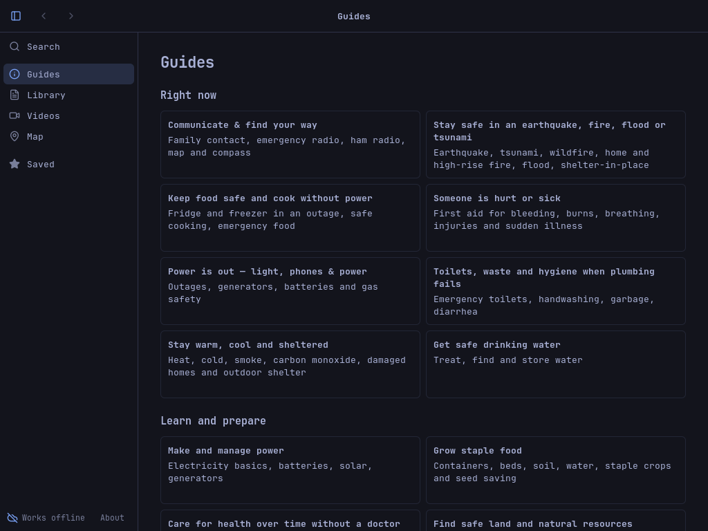

# Lastbook for Omarchy

An offline survival library for [Omarchy](https://omarchy.org): manuals, how-to videos, encyclopedias, short guides for
urgent needs and a map of the world, all on your own computer. After setup it needs no internet. Read it in its window,
or ask the AI agent you already use: Lastbook gives the agent a command line and a skill, and has no AI of its own.



It is a hard fork of [Lastbook](https://github.com/Immortal-Protocols/lastbook) (<https://lastbook.org>), rebuilt as one
native Omarchy app ([what changed](#how-it-differs-from-lastbook)). MIT licensed, as upstream.

## Install

On Omarchy (x86_64, or aarch64 Apple silicon through Asahi):

```bash
curl -fsSL https://ferdousbhai.com/lastbook/install.sh | sudo bash
```

This adds Lastbook's signed package repository and installs `lastbook-for-omarchy`; running it again is safe. Updates
then come with the rest of the system (`omarchy update`). The installer works on plain Arch Linux too.

Open Lastbook from the application menu. First-run setup offers three libraries (Small, about 8 GB; Medium, about 67 GB;
All, about 388 GB) and the map: the whole world to city level (about 0.6 GB) plus street-level detail for the regions
you pick. It downloads and checks them, and can be paused and resumed. A library already on the computer (a folder or a
pack zip) can be used instead.

The installer offers [Recall for Omarchy](https://github.com/ferdousbhai/recall-for-omarchy), which adds search by
meaning (or later: `curl -fsSL https://ferdousbhai.com/recall/install.sh | sudo bash`). Without it everything works, and
search matches words.

To build the package from a checkout instead (needs Rust): `cd packaging/arch && makepkg -si`. To remove Lastbook:
`sudo pacman -Rns lastbook-for-omarchy`; your library and settings stay in your home folder (`~/.local/share/Lastbook`,
`~/.config/Lastbook`, `~/.cache/Lastbook`) until you delete them.

## What you get

- **Guides for urgent needs.** Fourteen short guides (someone is hurt, safe water, the power is out, …), each pointing
  at real pages of the library's sources, with what the sources warn about and what the curators could not find.
- **The library.** Manuals and saved web pages, videos with transcripts, and offline encyclopedias (ZIM files, such as
  MDWiki and Appropedia; Wikipedia in the largest pack), in a reader with find, zoom and saved pages.
- **Search across all of it.** One search over manuals, video moments and encyclopedia articles, by words and, with
  Recall, by meaning. Each result opens at its page, moment or section.
- **An offline map.** OpenStreetMap drawn in your theme's colours. Find any country, region, or town of 500 people or
  more; where you have street-level detail, *Nearest help* lists the closest hospitals, clinics, pharmacies, police,
  fire stations and drinking water. You pick the areas. When no street map covers where the computer is, Lastbook
  offers one as it opens, one press to download (it reads Omarchy's weather location or time zone, or asks your
  town, and sends nothing to find you).
  [docs/MAPS.md](docs/MAPS.md) has the details.
- **An Omarchy app.** One native GTK 4 window that follows your theme and language, driven from the keyboard
  ([Keyboard](#keyboard)).
- **Your agent can use it.** See below.

## Ask your own AI agent

Lastbook runs no model and has no chat. The agent already on your computer (Claude Code, Codex, or any other, with a
local model too, through Omarchy's `omarchy-local-ai`, say) answers from the library instead. Ask it in plain words:

> My kid burned her hand on the stove. What do I do? Use Lastbook.

The agent searches the library, reads the pages behind the best results, and answers with the document and page beside
each claim, saying so when the library does not cover something. Two things make that work:

**The skill** (`skills/lastbook/SKILL.md`) tells an agent when to reach for the library and how to search, read and
cite. Lastbook installs it for you at `~/.agents/skills/lastbook`, linked from `~/.claude/skills` and `~/.codex/skills`,
and keeps it current. `lastbook skill` prints it, for an agent that looks elsewhere; `lastbook skill uninstall` removes
it and keeps it removed; `lastbook skill install` puts it back.

**The command line** answers from the same library as the window, as JSON on standard output, with no window:

```bash
lastbook search "treat a burn" --read             # ranked passages (doc_id, title, page, excerpt, trust), the best four with their whole page
lastbook read med-443ae5cfaa6ecc68 --pages 37,38  # the text of PDF pages, an encyclopedia article (zim:…) or a saved page
lastbook page med-443ae5cfaa6ecc68 38             # one PDF page as a PNG (in ~/.cache/Lastbook/pages, or --out FILE)
lastbook transcript VIDEO_ID --query "tinder"     # a video's timed lines
lastbook place "Denpasar" --nearby hospital       # a town or "LAT,LON", and the help points near it
lastbook guides; lastbook guide hurt              # the guides, and the pages one points to
lastbook status                                   # library folder and counts, meaning search, map files
lastbook open med-443ae5cfaa6ecc68 38             # a window at that page; also routes: guide:hurt, search:burns
```

`lastbook --help` lists every command. A command exits 0 on success (no matches too) and 1 on any failure, with one line
on standard error saying what. `--data FOLDER` names another library. Commands run beside an open window, read only the
library, and write nothing but the engine's caches. `lastbook place --nearby` answers for the street-level regions
installed, and says plainly when none covers a place; `place` and `status` also tell the agent when no street map
covers where the computer is, for it to pass on (no command downloads anything). The library's files are also at one stable path,
`~/.local/share/Lastbook/library`, for an agent's `grep` and `jq`.

Search by meaning needs an index of the library, which the `lastbook-index` user service builds in the background
through Recall (an hour or more for a new library; `lastbook status` shows how far it is, and `lastbook index` builds it
in the foreground). To switch it off: `systemctl --user mask lastbook-index.service lastbook-index.path`.

## How it differs from Lastbook

| | Lastbook (upstream) | Lastbook for Omarchy |
|---|---|---|
| Runs on | macOS, Windows, iPad, and in a browser | Omarchy and Arch Linux, as one native window |
| Questions | A built-in assistant on a local model | Your own agent, through the `lastbook` command line and skill |
| Search by meaning | Its own embedding model | Recall for Omarchy's, if installed; nothing bundled |
| Search | Manuals and videos | Encyclopedia articles too |
| Map | US map files shipped in the packs | The world, cut on your computer from OpenStreetMap, any of 554 regions at street level |
| Install and updates | Installers and an update checker | A signed pacman repository; `omarchy update` |

The library packs are upstream's own, pre-built, from `downloads.lastbook.org`. Upstream's websites and pack-building
tools are not in this fork. The app opens no network port, and reaches the network only for the downloads you start in
setup (below).

## Privacy and network use

- **No listening port.** The desktop app opens no network port. The window (`native/`) and the engine talk in JSON lines over
  the engine's standard input and output (`app/engine_pipe.py`, through the in-memory bridge `app/bridge.py`). Meaning-based search asks Recall for Omarchy's
  EmbeddingGemma over a local Unix socket in the user's runtime folder; nothing of it leaves the computer.
- **One use of the network, started by the person.** Setup's downloader (`engine/setup/`), when the person starts or
  resumes a download, or presses *Check for newer libraries* (one request for the published list). Opening setup reaches nothing. It goes through `engine/setup/download.py`, the only module that opens a connection: HTTPS on port
  443 only, to allow-listed hosts only (`downloads.lastbook.org` for upstream's packs and the manifest; Protomaps' build hosts for the map; `download.geonames.org` for place names), no proxy
  from the system, and a redirect is followed only to another allowed host.
- **Pinned trust.** The downloader trusts only the root certificates in `engine/setup/roots.pem` (6 roots from Mozilla's
  bundle), never the system's trust store. `python3 -I -B packaging/check_tls_roots.py` checks that those roots
  still cover the allowed hosts; it needs the network, so `bin/release` runs it and `bin/check` does not.
- **Checked files.** Every download is checked against the SHA-256 in the manifest before it is used. Zips are checked
  for unsafe paths, links and sizes before anything is written.
- **Where you are, without asking anyone.** To offer a street map you lack, Lastbook reads the weather location you
  set in Omarchy, or else the town you gave it or the system's time zone, and the kernel's routing table to see whether you are online
  (`engine/setup/here.py`). Nothing is sent, nothing is downloaded until you start it, and the switch under Map in
  Library and downloads turns the offer off.
- **Nothing else.** The window blocks all web loads, there is no telemetry, no account, and nothing runs on a timer or at
  startup that reaches the network.
- **A working library is never broken.** New data is unpacked beside the old one, checked, and then switched in with a
  single rename. A failure at any step leaves the old library as it was.

The setup contract, with what each file of `engine/setup/` does, is in [docs/SETUP-API.md](docs/SETUP-API.md).

## Keyboard

| Keys | Where | Does |
|---|---|---|
| ?, F1 | Everywhere (`?` not while typing in a field) | Shows or hides every shortcut |
| Ctrl+K | Everywhere | Goes to Search, with the keyboard in its field |
| Ctrl+F | The reader, a web page or article | Finds in it, with the keyboard in the find bar |
| Ctrl+F | Any other screen | Goes to Search, as Ctrl+K does |
| Enter, Shift+Enter (also Ctrl+G, Ctrl+Shift+G) | Find in a document or page | The next match, the match before |
| Escape | Find in a document or page | Closes the find bar, and the page has the keyboard again |
| Ctrl+C | A web page or article | Copies the text selected in it |
| Ctrl+B | Everywhere | Shows or hides the sidebar |
| Alt+Left, Alt+Right | Everywhere | Back and forward through the screens visited |
| Ctrl+D | A page, article, video or guide | Saves it, or removes it from Saved (the note that appears offers Undo) |
| Ctrl+W, Ctrl+Q | Everywhere | Closes the window and quits (Lastbook has one window); while a download runs, asks first |
| Escape | A question | Answers with the choice that loses nothing |
| Up, Down | The sidebar | Moves to the screen above or below |
| Enter, Space | A card | Opens it |
| Left, Right | The reader | The page before, the page after |
| Home, End | The reader | The first page, the last page |
| Up, Down, K, J | The reader | Scrolls within the page |
| Space, Page Down | The reader | Down a screenful, and on to the next page from the foot of this one |
| Shift+Space, Backspace, Page Up | The reader | Up a screenful, and back to the page before from the top of this one |
| +, - (also with Ctrl) | The reader | Zooms in, zooms out |
| 0 | The reader | Fits the page to the window's width |
| +, - | The map | Zooms in, zooms out |
| Left, Right, Up, Down | The map | Moves the map |

The reader's and the map's single keys (K, J, 0, +, -, Space) are letters typed while a text field has the keyboard.

## Language

The window follows the language picked in Omarchy (Setup > Region > Language) as it runs, and reads right to left in
the languages that do. Its own words are in `native/src/i18n/en.json`, the list translators work from; English is the
only catalog so far. The library itself (manuals, videos, encyclopedias, and the curated guides, which cite English
sources page by page) stays in the language it was written in. The command line answers in English, for scripts.

## What's where

| Path | What it is |
|---|---|
| `native/` | The desktop window: a Rust crate (binary `lastbook`, which is also its app id, desktop entry and icon name) on GTK 4, WebKitGTK 6 and Poppler. It starts the engine as a child process. |
| `app/` | The engine's side of the app: the pipe the window talks to (`engine_pipe.py`), the command line (`cli.py`), library lookup and setup hooks (`main.py`), the no-port bridge (`bridge.py`), and tests (`app/tests/`). |
| `engine/` | Paths, the request handler's base and file rules (`library.py`), saved pages, the help points of `place --nearby` read from the street-level maps (`map_pois.py`) and setup (`engine/setup/`, which also makes the map). |
| `server.py`, `retrieval.py`, `encyclopedia.py` | The engine: request handler and the fused search (`server.hybrid`), meaning-based search (through Recall), and encyclopedia articles as passages. |
| `skills/` | The agent skill (`lastbook/SKILL.md`), built into the program (`lastbook skill`). |
| `content/` | The curated guides (`topics/*.json`) and what curators looked for and did not find (`gaps.json`). Format: `content/SCHEMA.md`. |
| `packaging/` | The Arch package (`arch/`: PKGBUILD, the manifest and map region list it ships, the package scan), the desktop entry (`linux/`), the icon (`icon/`), the TLS roots tools. |
| `tools/` | Curator helper (`validate_topics.py`), the map area list's maker (`make_region_list.py`), and the retrieval check (`eval/`). |
| `docs/` | How the window and the engine talk (`ENGINE.md`), the setup contract (`SETUP-API.md`) and how the offline map is put together (`MAPS.md`). |

## Run from source

You need Arch's Python 3.14 (the pinned libzim and pypdfium2 wheels are built for it), `python-numpy` from
pacman, Rust, the GTK 4, WebKitGTK 6 and Poppler development files (the Arch packages in the
PKGBUILD's `depends`), and a **data folder**. A data folder holds `library-data/catalog.json` (the library) and gets a
`derived/` folder for the map, indexes, caches and logs. Get one by running the app once and letting setup download a
pack, or by unzipping a pack from lastbook.org.

```bash
cargo build --manifest-path native/Cargo.toml
LASTBOOK_DEV=1 PYTHONPATH=$(bin/test-deps) native/target/debug/lastbook --data /path/to/LastbookData
```

`bin/test-deps` unpacks the two wheels the PKGBUILD pins and prints their folder. `LASTBOOK_DEV=1` lets the engine
(`/usr/bin/python3 app/engine_pipe.py`, started by the window) take its dependencies from `PYTHONPATH`. Without `--data`, the engine checks `LASTBOOK_DATA`, the folder chosen last time, and its own data folder.
Existing libraries elsewhere are accessed when the person chooses them. If no library is available, it opens setup.
The full order is in `app/main.py`.

## How search finds passages

The window's Search and `lastbook search` both go through `server.hybrid()`, which fuses keyword search (the library's
FTS5 index), meaning-based search (through Recall for Omarchy, when it runs) and the encyclopedias into one list of
passages, each with its document and page, video moment or article section. How each part works is in
[docs/ENGINE.md](docs/ENGINE.md#search); `tools/eval/run.py` measures hits@8, MRR and timing on `tools/eval/questions.json`
against a real data folder.

## Build

`packaging/arch/PKGBUILD` builds the package from the committed source (`git archive HEAD`): the window
(`cargo build --release --locked --manifest-path native/Cargo.toml`, installed as `/usr/bin/lastbook`) and the two Python packages Arch does not carry (libzim and pypdfium2, pinned wheels). Everything else comes from Arch. Check a
built package with `python3 packaging/arch/scan_package.py <package>`. Releases: `bin/release <version>` (with
`packaging/release-notes.md` written first) tags, builds both architectures natively in CI (`.github/workflows/packages.yml`,
`bin/build-packages`), signs the packages and repository databases locally and publishes them with `install.sh`.
Release day, in order: commit the release notes on main; publish this commit's `install.sh` at
`https://ferdousbhai.com/lastbook/install.sh` (verification compares the two); run `bin/release <version>` (a run
stopped part way is resumed by running it again); `verify-release.yml` then installs the release on both
architectures.

## What is not in this repository, and why

- **The library** (`library-data/`): hundreds of gigabytes of third-party manuals, videos and encyclopedias, each under
  its own terms. It is distributed as packs, with a Sources and permissions page in each pack.
- **Maps**: large, and built from public data. Setup makes the map on the person's computer.
- **Generated data** (`derived/`, builds): indexes, caches and logs the engine makes as it runs, and build output.
- **Release and signing material**: signing keys, deploy settings and the release folders.
- **Private data**: a household's own home area, machine and user names, keys and internal security-audit notes. The
  guides here are in general wording and ship as they are. Contributors must not commit personal details; the package
  scan checks for home-folder paths.

## Tests

```bash
bin/test
```

It runs the window's tests (`cargo test`, then its screens driven offscreen by the scripts in `native/dev/qa`, where any
GLib warning fails the run; a script with a stand-in engine beside it shows what the window does while the engine is slow,
when it fails, and while a download runs) and the engine's (`python3 -m unittest`, with libzim and pypdfium2 from the
PKGBUILD's pinned wheels, `bin/test-deps`). `test_bridge` builds its own made-up library, which `test_cli` runs the commands against; `test_semantic` runs a stand-in
Recall; the others run without a library. `bin/check` adds the installer test.

## Contributing and licence

See [CONTRIBUTING.md](CONTRIBUTING.md) and [CODE_OF_CONDUCT.md](CODE_OF_CONDUCT.md). Lastbook’s original code and
documentation use the [MIT License](LICENSE), permitting commercial use, modification and redistribution with the
copyright and license notice. Third-party software, media and library content retain their own licenses,
listed in [THIRD_PARTY_NOTICES.md](THIRD_PARTY_NOTICES.md) and each library pack. Distributed packages include
GPL-covered components such as python-libzim and libzim and must also meet those components’ license obligations.

